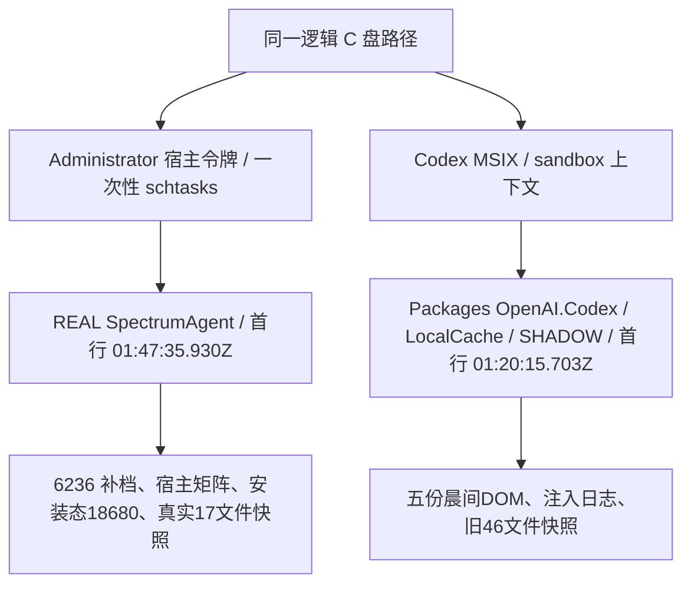

# 最终交付候选验收报告（2026-10-19）

## 完成到哪一步

交付固定为 **22a13e6a / d8492536**，不再改动、不重打包。**VM 实机项已于2026-10-19由两轮云电脑实测等效关闭，检查点4正式封账**（负责人裁定：关键路径全覆盖、无红线命中）。本地 Hyper-V 不再阻塞本里程碑，VM 保留 pristine→accept-4 链供后续补测。握手残留记已知问题、不进 0.1.1 热修、不阻塞封账；exit code=70 与注册键历史消失原因仍维持“未定位/未验证”，不追查、不互相解释。缓测项不记为通过。不改封版引擎、不重 bundle、不把 29a 行为复验升级为交付候选。

| 对象 | SHA256（全小写） | 字节数 |
|---|---|---:|
| setup.exe | d849253611c1ac985cb08a60a7073e17ed6c89b74e8230532d0c3d2157cc8107 | 287156790 |
| 外壳 spectrum-agent.exe | 22a13e6a4d2ec88cf58fa349aad7f22e61fa11331adca11e11eec9c781f73471 | 10786304 |
| 冻结引擎 app.exe | 3f62c1895152a01eb0a92b61a733985c15ca7888d233fd9408ca5b9dc61d7703 | 16771455 |

产品源码提交 a53030d47fc169ddfa67057e45c464fc0f1db2cd。交付绑定 `candidate.json` 与 `analysis-20261019T015517607982Z.json`；引擎唯一权威清单为 `artifacts/step2/revision-20261018-smoke-headers/product-manifest.json`，SHA256=4d10246996bd3ac2a002bd62b50c6e59df8f194477bbac7546bef1e5b6619f2c。artifact_source_commit=3acd979f3b5a94ad32283eb1608c95f0b8721696，manifest_generator_commit=e7c3c9d90f83d23639a4ee54832c8b4bc75bf706，二者分离；未改旧清单/旧输出/旧 REPORT。

## 血缘、适用范围与旧证据裁定



真实根固定字面路径 `C:UsersAdministratorAppDataLocalSpectrumAgent`；影子物理根为 `C:UsersAdministratorAppDataLocalPackagesOpenAI.Codex_2p2nqsd0c76g0LocalCacheLocalSpectrumAgent`。后续真实根/注册表访问不通过 LOCALAPPDATA 展开，也不把日志里相同的逻辑路径视为血缘证明。全部新任务主体为 WIN-RTKE72PB5BEAdministrator，SID 结尾 -500，InteractiveToken / LeastPrivilege；任务创建、执行、查询、删除原始输出逐份归档，非周期自动任务。

| 证据集 | 实际来源与判定范围 |
|---|---|
| 22a 晨间30轮矩阵 | Explorer 宿主启动，矩阵 original-shell.log 首行01:47:35.930Z，REAL；负责人已复核，各10轮，不重跑。 |
| 22a 五份生产态 DOM（10452/30208/28200/17240/3996） | 同源 SHADOW，original-source-snapshot 首行01:20:15.703Z；仍是22a生产UI/注入行为证据，不能证明真实根数据保留。 |
| pre-repro 46文件卸载快照 | SHADOW；负责人污染判定成立。**撤销其“真实数据根数据保留已验证”主张**，保留原件作为历史，未改写结果。 |
| 6236 shell531–555 / engine211–222 | REAL，复制源与首行血缘已核；shell原档不重做，engine另补完整窗。 |
| 29a 三组矩阵 | REAL宿主，首行01:47:35.930Z；仅同源重编行为复验。 |
| 29a 注入、NoBundle DOM25144与原始日志 | SHADOW，首行01:20:15.703Z；仅行为附录，不能顶替宿主数据验证。 |
| 29a 安装态29012/28972/26620 | REAL宿主，前两次45s采样未覆盖Stopping，26620覆盖完整；全部保留，不作为交付22a正式安装态证据。 |
| 本次交付22a安装态18680 | REAL，宿主schTasks；原始DOM+shell/engine分段+源副本+CreationTime/整文件SHA/偏移齐全。 |
| repro-real-cleanup16项、本次交付17项快照 | REAL，先验01:47血缘，相关进程全退后读取；仅本次17项是交付包真实根卸载验收依据。 |
| 其它历史features=[]证据 | 只对当时进程生命周期有效，不用于生产资源/UI加载。旧包56b/cba09:32–09:41安装卸载35文件结果按负责人已验收事实引用，不冒充本次真实根17项。 |

逐份归档路径、首行、整文件SHA、尺寸见 `EVIDENCE-LINEAGE.json`。live血缘基准：CreationTimeUtc=2026-10-19T01:47:35.9303040Z；本次首次读取757146字节、SHA=f9643ffd48c473e9470d20519250b13fa8c2e603ab0231b402b46a4d3ab37039。先复制源再从副本归档，后续追加不倒改旧SHA。

## 复现性真重编与明确结案

判决：**不可字节复现；来源一致，差异限于链接期元数据（时间戳/PDB GUID）**。

`repro_check.ps1` 真正重编主bin/lib/build script，独立 CARGO_TARGET_DIR=`E:AI_Agentsrc-tauri	arget
epro-check`，不覆盖已绑定target/release；仅复用依赖缓存，排除了本项目指纹/build/deps。rustc 1.99.1 (58cf8f9c3 2026-10-13)，profile=release，features=custom-protocol，RUSTFLAGS为空，原始构建日志打印 `$env:RUSTFLAGS=[]`（方括号之间无字符）；conditions JSON为 `"RUSTFLAGS": ""`。产品源码 a53030d..HEAD 及工作区对照均为空，三套lock未变。`repro-build-conditions.json`、`repro-build-output.txt`、`repro-build-result.json`、`repro-dist-before.json`/`repro-dist-after.json` 保存全部条件与dist逐文件SHA。

dist三文件路径、尺寸、SHA均一致，包含 Vite 内容哈希文件名 index-BVBpdjoe.js / index-DlY-5qsv.css；不是只比较文件名。重编29a2829b与22a均10786304字节，仅24字节不同：COFF时间戳偏移248改变2字节；DEBUG时间戳偏移8510228/8510256/8510284各2字节；RSDS PDB GUID改变16字节（af87bc6e…→66d43739…）。.text/.data/.pdata/.rsrc/.reloc逐字节相同；.rdata原始字节有上述内嵌调试元数据差异，归一化后相同，不能声称.rdata原始字节全同。无未解释差异，IMAGE_DEBUG_TYPE_REPRO未使用，MSVC /Brepro未生效，属于链接期非确定性。

旧cba991aa与22a备份均10786304字节，28字节差异也完全由时间戳/PDB GUID覆盖，归一化后相同、未解释差异0。`repro-pe-comparison.json` 保存每个PE段SHA、偏移和差异分类；`compare_pe.py` 是可复核入口。无需进一步猜测代码生成或资源变化。

负责人最终裁定：交付继续使用22a/d849；29a及其2b734cc7包**不是第三候选**，不重bundle，晨间矩阵和安装证据不作废。`bundle-idle` 日志明写不重编译，只证明打包稳定性，未将它作为复现性证据。

## 已安装交付包正式取证与原始输出入口

实际命令（由宿主Explorer broker仅用于发起、schtasks以真实交互令牌执行，不由MSIX上下文直接安装）：

```powershell
& 'C:\Windows\System32\WindowsPowerShell\v1.0\powershell.exe' -NoProfile -NonInteractive -WindowStyle Hidden -File 'E:\AI_Agent\artifacts\step3\checkpoint-4\release-custom-protocol-20261018\final-canonical-20261019\start_host_task.ps1' -Action InstallDelivery
# 一次性任务中的实际安装：
& selfcheck_install.ps1 -Phase Install -EvidenceTag delivery
# Start-Process 精确setup路径，参数 /S，Wait，WindowStyle Hidden
& start_host_task.ps1 -Action ProbeDelivery
# 先核对安装SHA，再 host_installed_probe.ps1 -Label installed-delivery -BindingName candidate.json
& start_host_task.ps1 -Action UninstallDelivery
# 任务内严格 PrepareUninstall -> Uninstall，两者均使用同一final-canonical目录
```

命令完整绝对路径、SID、一次性XML、创建/运行/查询/删除与执行时间保存于 `real-task-*-scheduler-output.txt`/`*-scheduler-receipt.json`/`*-result.json`；原始stdout `delivery-install-output.txt`、`delivery-installed-payload-output.txt`、`delivery-installed-rt-manifest-output.txt`、`delivery-prepare-uninstall-output.txt`、`delivery-uninstall-output.txt`。上面相对脚本名仅为阅读缩写，任务XML保存实际命令绝对路径。

安装06:31:52.974Z开始、06:32:44.789Z完成，setup=d849。默认目录 C:UsersAdministratorAppDataLocalProgramsSpectrumAgent，shell=22a；完整544文件引擎manifest一致，_internal543，安装持久文件546（外壳+544资源+NSIS生成卸载器），无supervisor-probe/stub。安装态两个exe实际提取RT_MANIFEST，shell与engine均longPathAware正确命名空间/asInvoker/CommonControls v6，SHA与交付绑定；XML在staging-reports内，无向resources写证据。

本次 shell PID **18680**、engine PID **30556**、boot **e5c7dd59**、port **57110**。引擎实际路径 `C:UsersAdministratorAppDataLocalProgramsSpectrumAgent
esourcesackendapp.exe`，故意设置无效SPECTRUM_ENGINE_EXE未生效。发布态URL为 `http://tauri.localhost/`，不是devUrl。

真实curl响应全文见 `installed-delivery-health-http.txt`（原始HTTP头也在文件中）：

```json
{"status":"ok","boot_id":"e5c7dd59","pid":30556,"version":"0.1.0","uptime_s":0.203}
```

安装态前端invoke产生真实结果（engine日志smoke_completed与DOM同时佐证）：

```json
{"nan_ratio":0.0,"reflectance_range":[-1.5275289241381491,1.5275289241381491],"bands":8,"shape":[8,8,8],"elapsed_ms":208.095}
```

`dom-18680.jsonl` 原文件从REAL acceptance目录逐字节复制，339695字节，SHA=ea01dd4a8facdac967bdbdb2ad590621c754eb94cd5c15fce7ec8ce11e7ec63b。221帧：Starting7、Ready210、Stopping4；URL全部为内嵌地址，localStorage/sessionStorage均0。实际本轮token原串与完整握手精确扫描0命中，Authorization: Bearer 0。token只在探针内存用于扫描，握手归档已打码。

伴随原始日志 `installed-delivery-shell.jsonl`（123680字节、SHA37b6e5418a1b3edddcc4fff0a8374024c80a92080d3b1976cb055d63f274bde5）、`installed-delivery-engine.jsonl`（2551字节、SHAf6a72b9148e7435c7f02509a3d33e4a1d1ba95d62bbff65b9373b5cc19f90e6d）。shell源偏移757146..880826，时间窗06:33:25.602Z–06:33:48.305Z；engine87346..89897，06:33:26.455749Z–06:33:37.247216Z。每行偏移、时间戳、CreationTime、源副本和整文件SHA均在 `installed-delivery-result.json`。无同窗外并发相关进程。

第二实例PID30580 exit0，握手字节未变、只存活首实例18680和其引擎；原始shell段有 `single_instance_activation @06:33:27.008Z`，不是首实例lock_acquired冒充激活。正常Alt+F4后Ready→Stopping(reason=application_close)→app_exit→host_cleanup_completed(success=true)，持有原生进程句柄读exit0；无残留相关进程，端口监听0。**host_cleanup_completed仅证明本实现回收流程完成，不能据此推导握手删除：实际handshake仍在，PID30556不存在，handshake_cleanup_passed=false。该额外握手清理要求未通过，保留原始判定，不删除文件冒充通过。**

## 6236旧安装态升格、18188与1412

shell6236的25行531–555，02:23:38.992Z–02:23:47.936Z，原段SHA8a5a15fa2650853740b9f81760c3828f61cf614a13dd15bd926bbd4d9ecb13ba，偏移64269..67384，负责人已核逐字节一致，本轮不重做shell。旧 `legacy-6236-engine.jsonl` 缺engine_boot，保留；补档 `legacy-6236-engine-complete.jsonl` 从复制源按完整02:23:39–02:23:46窗截取211–222共12行，首行engine_boot @02:23:39.846349Z，pid26088（该首行原生没有boot_id，不伪造补字段），后续同pid boot11222372 / port55857。完整段SHA4acb2bb985a89bb6cbdd21e4aaa4143928a17b86ca86bbb017fef55ded386869；源snapshot与逐行偏移、CreationTime、源SHA见 `real-task-CaptureComplete-result.json`。首轮脚本错误强求boot字段导致失败，`real-task-Capture-result.json` 保留；更正仅涉及证据提取条件。

旧6236链：Starting→Ready1268ms→smoke Ok（8bands/182.431ms/nan_ratio0）→Stopping→app_exit/host_cleanup success；这是日志证据，**无DOM/URL**。不得补造。

pid18188：负责人已核验02:03:39启动、约一分钟内退出，stderr仅1412一行（10:04落盘）；真实数据根日志无18188记录、无DOM/UI证据、退出原因未定位。**不称已关窗，不归因Esc。** 影子根同PID素材不能与该宿主会话合并。

1412在29a真实安装态probe3再次出现，原文在 installed-probe3.stderr.txt：

```text
[1019/123958.781:ERROR:ui\gfx\win\window_impl.cc:172] Failed to unregister class Chrome_WidgetWin_0. Error = 1412
```

本次交付22a installed-delivery.stderr.txt 为0字节，未复现。历史出现与本次未出现分别陈述；1412原因未定位，不猜测与退出、WebView2版本或焦点的因果。

## Failed=20按DOM采样帧归属

| DOM文件（均来自原始五份同源归档） | Failed帧数 | 归属 |
|---|---:|---|
| dom-10452.jsonl | 0 | 30轮矩阵相关生产会话，无Failed帧 |
| dom-30208.jsonl | 1 | invalid-json注入 |
| dom-28200.jsonl | 1 | missing-fields注入 |
| dom-17240.jsonl | 1 | missing-dll-plus-invalid-json注入 |
| dom-3996.jsonl | 17 | retry-unknown同一失败页反复采样 |
| 合计 | 20 | **采样帧数；不是20次失败或20个用例** |

dom3996成因链：一次 taskkill 终止 engine PID30700（retry-unknown-engine-kill-output.txt 有SUCCESS）→ engine_process_exit code1 @01:54:03.934Z → Ready→Failed(reason=engine_failure) → 100ms同页轮询17帧 ticks433–449、elapsed44043–45653ms直到45s探针窗口结束 → generation2 @01:54:17.964Z retry_after_cleanup自动恢复。完整时序见 `FAILED20-ATTRIBUTION.md`、原始五DOM与analysis，不把轮询帧数当故障次数。

### timeout_test_host（不在上述20帧内）

StartupTimeout约30010ms；Starting heartbeat298，最大gap104ms、queue8ms；Starting可见次数0，第二实例pending_activation=true、内部invoke返回Starting。来源当前源码debug测试宿主，不冒充真实引擎制造超时，不并入Failed20。

## 真实数据根卸载、state规则与注册表异常

全程同一final-canonical目录。Install守卫只判state文件/程序目录/卸载注册键三项，任一存在即throw；记忆键独立OWNED_PRIOR_TEST_KEY交叉核验、不触发三项守卫。本轮未绕过守卫、未删记忆键、未新建证据目录。卸载成功后立即UTC改名归档state并记录源/目标SHA；旧10:03state、reprostate、交付state三份历史均保留。

负责人2026-10-19复核裁定：同目录 repro-real-cleanup 原始结果（1→16、bytes_unchanged=false）属于复现链场景，卸载前注册键本就不存在、窗口内应用自生成文件，非卸载毁数据。原始输出、`real-task-RecoverRepro-result.json` 及先前脚本计数解包诊断均保留，不将该场景作为封账依据；本次卸载封账依据固定为 `host-uninstall-result.json`（真实数据17→17、字节不变、uninstaller exit0）。

最终交付PrepareUninstall→Uninstall在所有相关进程退出之后执行，data-before/after各17文件（含db sqlite3/-shm/-wal、logs、run、testdata与acceptance实际条目），逐字节一致；run/logs/testdata三个本轮preservation标记SHA均未变。program目录移除，卸载器exit0。`data-before-uninstall.json`、`data-after-uninstall.json`、`uninstall-markers.json`、`host-uninstall-result.json` 是本次交付真实根依据。前后快照以字面路径与01:47血缘为依据，不靠脚本写出的路径字符串证明来源；本轮数据与db条目在所有相关进程退出后冻结，不把运行态shm/wal变化算卸载失败。仅在通过判定和state归档后清理三个确切自有标记，标记为 **TEST_HYGIENE_ONLY，不作为通过依据**；没有清洗剩余握手。

**注册键异常仍未定位。** 负责人11:17/11:31看到卸载键与记忆键在HKCU/HKLM及WOW6432Node四视图均缺失而程序完好，已记录。旧repro卸载前真实卸载键也已缺失，因此其DeleteRegKey为空操作，不能证明键清理；之前sandbox看见键不是宿主真实视图。本次非重定向重装则确实创建两个真实HKCU键，首次正常关闭后两键仍在；本次最终卸载前卸载键存在、卸载后消失，记忆键仍在且未人工删除。**本次成功不解释先前消失原因。**

记忆键归属（2026-10-19负责人确认，并与源码逐行核对）：`HKCU\Software\spectrumagent\SpectrumAgent` 为 **Tauri 2 NSIS 标准安装器行为，非 harness 残留**。`src-tauri/nsis/installer.nsi:68-69` 定义 MANUKEY/MANUPRODUCTKEY，`:698` 写入默认值为安装目录，`:164-166` 配置同键的 `Installer Language` 值，`:889` 在勾选删除应用数据且非更新时删除该键。纯安装后该键应存在；值内容细节按下述缓测清单记录，不把未归档细节补写为通过。

会话历史 `registry-history-audit.json` 扫描811条工具输入、无手动reg写入/删键等命令；本轮此后脚本也没有手动注册表写删操作。NSIS安装/卸载本身的WriteRegStr/DeleteRegKey另列为预期安装器行为。未找到手动操作来源，原因未定位。影响：键缺失时Add/Remove Programs入口缺失；程序运行与uninstall.exe直跑不受影响。

VM注册键三时点判据及验收流程修正见 `VM-BUILD-Win11Clean.md` 与 `VM-ACCEPTANCE-CHECKPOINT4.md`。**VM 实机项已于2026-10-19由两轮云电脑实测等效关闭，检查点4正式封账**（负责人裁定），本地 Hyper-V 不再阻塞本里程碑。`reboot` 独立采集轮、截图三件、`timings.txt` 精确值、记忆键值细节、长路径>260、exit code=70、签名/SmartScreen 详录均列为**缓测，不记通过**；历史注册键消失原因维持未定位，不追查、不互相解释。

卸载页“删除应用数据”复选框实际删除APPDATA/LOCALAPPDATA下的 `com.spectrumagent.desktop`（BUNDLEID，WebView2用户目录），**对真实 `%LOCALAPPDATA%\SpectrumAgent` 数据根无效**。不能用复选框作为真实数据保留/删除验收证据；产品级“删除真实应用数据”缺口记后续项。本轮按批准范围仅改模板currentUser默认安装目录一行，未扩改卸载逻辑。

## 20项验收对照（沿用已核结果，不重复跑）

| 项 | 结果与可复核证据 |
|---:|---|
| 1 静态/构建 | 已核：fmt/clippy/22单测+1compile_fail、tsc/Vite、真正custom-protocol --no-bundle；BASE的fmt-prebuild-execution.json/clippy-output.txt/tests-output.txt/custom-protocol-build-output.txt及本目录绑定；features=[]不作生产证据。 |
| 2a/2b/2d Supervisor/Win32/解析 | 已核：checkpoint1/2/3原始输出，五类API失败顺序/句柄/严格契约解析；本轮不重跑。2c见新旧真实release证据。 |
| 3 dev SpawnFailed | 已核开发测试不存在路径即时失败；不能把release无效env当SpawnFailed。 |
| 4 缺DLL双级/最终完整边界 | 已核FaultFixture只有python312.dll缺失，543；正式Canonical544全量一致，本次安装态再核544，夹具标记不进resources。22a缺DLL+非法握手729.377ms进入ExitedBeforeReady，主因不被非法握手抢走。 |
| 5 Resume失败 | 已核注入TermJob，不是TermProcess；checkpoint1原始顺序。 |
| 6 代次竞态/Stopping | 已核单元测试、retry generation2与本次Ready→Stopping；不因正常停止产生EngineExitedAfterReady。 |
| 7 隐藏窗口不阻塞 | timeout_test_host专用debug证据：298 heartbeat/pending_activation/invoke，非真实引擎超时。 |
| 8 四态可见性 | 晨间五DOM/注入Failed及本次安装态Starting7/Ready210/Stopping4。Starting隐藏以日志证明。 |
| 9 单实例 | 已核Starting/Ready；本次安装态第二PID30580exit0、single_instance_activation、只剩primary18680。 |
| 10 常驻条/invoke | 旧同源五DOM、Ctrl+K/Ctrl+Enter/unknown/retry证据；本次安装态smoke208.095ms与DOM真实结果。 |
| 11 三段计时 | 22a宿主1070.768ms就绪/1153.768ms可交互/首次完成19252.768ms（含手动等待17879ms；调用往返220ms、算法211.154ms）。新WebViewprofile但OS缓存未清，负责人2026-10-19裁定VM实机项经两轮云电脑实测等效关闭；timings.txt精确值仍缓测，不补写≤3s精确值通过。 |
| 12 正常关窗10轮 | 已核22a的Close10轮进程/端口0残留；本次安装态再证无孤儿。**本次额外“握手清理”未通过，残留死PID握手，不混入进程回收通过结论；2026-10-19负责人裁定为已知问题、不进0.1.1热修、不阻塞封账。** |
| 13 强杀Ready10轮 | 已核22a KillReady10，Explorer父进程不在Job，独立release非npm/dev父Job掩盖。 |
| 14 握手前强杀10轮 | 已核22a KillStarting10，精确子PID/路径判孤儿，端口未发布null不假造端口。 |
| 15 陈旧握手隔离 | 已核新旧boot/pid；本次真实安装启动 engine stale_handshake_removed，未把旧死PID就绪。 |
| 16 token零泄漏 | 22a原样11实际token/完整握手精扫、原五DOM审计0；本次本轮真实token/完整握手/Authorization精扫0，storage0。 |
| 17 状态机 | 已核四态，app_exit独立事件；Failed20按帧归属，不叫第五态。 |
| 18 resolver/布局 | 生产资源--no-bundle实际544，release忽略无效env；本次安装实际resources/backend/app.exe，资源未入库，无test-probes。 |
| 19 locks/git | 三锁SHA未变，final-locks-and-product-source.json；最终提交后git-status-after-final-commit.txt只允许两份负责人md。 |
| 20 manifest | 源release+安装态双exe RT_MANIFEST实际提取、XML/SHA绑定；LongPathsEnabled历史值0，>260字符实际文件访问列为**缓测，不记通过**；不阻塞负责人裁定的检查点4封账。 |

## 工具、签名、安装目录与交付说明

setup.exe=**NotSigned**。

外壳/引擎exe=**NotSigned**。交付说明：Windows可能显示SmartScreen未识别应用/发布者警告；未签名状态如实交付，不关闭校验、不自动绕过警告。

WebView2载荷=**Valid / Microsoft Corporation**，214156024字节，SHA0625fb5c1e75be58a164e14f95aa58a3e5badb859b3d17c952385f3e4a9ff3e8。三类分别归档 `delivery-signature-three-way.json`，不合并称“签名链完整”。

官方工具NSIS3.13/plugin0.5.3，已批准的官方CDN直连下载字节/SHA1锚点/SHA256/时间/通道原始证据在BASE；WebView微软fwlink/CDN、Authenticode证据同在。历史代理失败/直连github000与CDN200分别留存，不倒改网络结论；未关闭TLS或吊销验证，无非官方镜像。缓存/target在E盘gitignore内，三锁不变。WebView外层1.3.287.9、签名内载荷Runtime155.0.4283.62；VM安装前后需比pv核对，预装Runtime导致跳过安装时不能声称已验证首次离线补装。

NSIS保持currentUser、offlineInstaller，模板只改第524行 `StrCpy $INSTDIR "$LOCALAPPDATA\Programs\${PRODUCTNAME}"`，保留509行/D=守卫、perMachine分支与卸载逻辑；不用hooks。upstream33780字节SHAc36f…、定制33789字节SHAe78b…的完整SHA与恰一行字节diff见BASE/template-provenance.json与upstream-installer.nsi/src-tauri/nsis/installer.nsi。CLI升级必须重新提取上游→算SHA→diff→重应用唯一一行，禁止漂移。程序目录只读语义，Rust AppPaths数据根未变。

交付路径 `E:\AI_Agent\artifacts\step4\setup.exe` 已从旧56b7551f替换为d849（287156790字节），全小写SHA相等；复制时间/源目标SHA/旧目标指纹见本目录 `step4-copy-record.json`，不把09:41旧copy_matches_bundle当新证据。二进制依既定规则在gitignore内，不提交target/dist/resources/node_modules/setup载荷；记录、源码、原始证据和XML入库。

## 同源重编29a行为复验附录（非第三候选）

29a真重编之后额外完成KillReady/KillStarting/Close各10轮，共30轮；repro-20261019T041645178Z /041754731Z /041849809Z 各结果/审计/每轮events/原始日志和Explorer收据均保留。29a独立target的bundle2b734cc7只为当时复验，后按终审卸载，不替换22a/d849交付。

NoBundle29a的dom25144 Starting15/Ready269/Stopping3；故障DOM23628/11548/26588各1帧Failed，合计3帧，与旧Failed20独立。非法JSON/缺字段主因为HandshakeInvalid，有引擎因果日志；缺DLL+非法JSON无Python因果日志，主因ExitedBeforeReady，复验输出均归档。repro-failure原始日志为SHADOW，不借此证明REAL根。

29a安装态29012与28972因超过45s采样窗缺Stopping，**两次探针失败原样保留**，不伪装全相位；第三次26620覆盖Starting7/Ready218/Stopping4，exit0、无孤儿、token0，握手同样残留，stderr1412如上。29a安装载荷544/manifest双提取/签名均有独立记录；它们只在附录，交付安装态正式证据为18680。

## 遇到的问题与待办

1. **未通过：安装态正常关窗握手清理。** 无进程/端口残留，但真实根仍有该死PID握手。没有修改封版契约、没有改交付二进制、没有用脚本删除冒充修复。**负责人2026-10-19裁定：记已知问题、不进 0.1.1 热修、不阻塞封账。** 理由：功能零影响，无孤儿进程/端口，token 每 boot 随机，`stale_handshake_removed` 自愈已实测两次；修复需动封版二进制、换包并重做全链证据，本轮不修。
2. 不可字节复现：已明确定位链接期元数据，结案口径按负责人裁定；未声称字节可复现。
3. 先前注册键无因消失、18188退出、1412原因、exit code=70内部原因均未定位/未验证，分别记录，不互相解释。
4. 真实数据删除复选框产品缺口后续处理；本轮未擅改模板卸载逻辑。
5. 证据提取engine_boot缺boot_id与WinPS5数组计数两项harness问题已修正，失败输出保留；46文件SHADOW污染撤回主张并用本次REAL17文件回归替代。

## 检查点4封账与缓测清单

**VM 实机项已于2026-10-19由两轮云电脑实测等效关闭，检查点4正式封账。** 此为负责人裁定（关键路径全覆盖、无红线命中），不冒充本地 Hyper-V 新增实测；本地 Hyper-V 不再阻塞本里程碑，VM 保留 pristine→accept-4 链供后续补测，本轮不执行恢复、删检查点或重新验收。

以下全部记为**缓测，不记通过**，不阻塞本次封账：

- `reboot` 独立采集轮。
- 截图三件（按验收流程补齐原始截图）。
- `timings.txt` 精确值；未坐实的 smoke 计时不写入本报告，待负责人指认轮次后另笔提交。
- 记忆键值细节。
- 长路径>260字符的实际访问。
- exit code=70：维持未定位/未验证，不追查，不与注册键历史消失互相解释。
- 签名/SmartScreen 详录；已有setup/外壳/引擎NotSigned与WebView2 Valid/Microsoft事实记录保留，不将待补详录写为通过。

注册键历史消失原因维持“未定位/未验证”，并列缓测，不追查、不互相解释。既有18188退出与1412记录保持原状。

VM手册第5步仍指向 artifacts/step4/setup.exe，不改交付包；负责人已修改的 `VM-ACCEPTANCE-CHECKPOINT4.md`、`VM-BUILD-Win11Clean.md`、`collect-vm-evidence.ps1` 随本次收尾提交归档。完成本次文档提交后原地等待里程碑 #02 任务卡指令；仅将 `TASK-02-数据接入.md` 纳入版本控制，不自行开工。

## 归档与提交纪律

216项是负责人11:41起点快照，不是完成阈值；所有非忽略新增证据、staging-reports剩余文件、CDN链接文件、本报告与VM手册一并入库。.runtime/已补gitignore。两份负责人文档不提交、不删除。最终提交之后再次实际执行 `git -c core.quotepath=false status --porcelain`，原始结果存本目录 `git-status-after-final-commit.txt`；完成口径固定：**除两份负责人文档外，无未跟踪、无修改**。不声称全仓完全干净。
