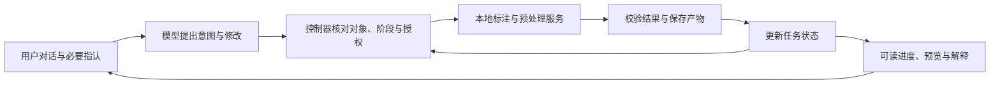

# TASK-11 对话标注与预处理：实现方案与验收契约

日期：2026-10-28。代码基准：`cdda282`。本文是设计与代码核查结果，不表示下述能力已经全部实现或真实模型验收通过。

## 1. 目标先用用户能看到的行为定义

项目的核心交付是：用户通过连续对话选择正确数据，完成有依据的标注、纠错与保存，再按其要求执行预处理和比较；系统保留已确认信息、展示实际进度和结果。

第一版必须满足：

- 用户不必复制 UUID、region_id、gesture_ref、recipe_version_id。
- 数据、候选、区域、配方具有可区分的显示名称和引用。
- 已经确定的数据、类别、参数策略不重复追问。
- “第二个候选”和“第二个配方”不能切换数据集。
- “只做标注”不能擅自进入预处理；“标注后预处理”不能在保存后丢掉后半段任务。
- 缺少材质依据时只询问这一项；没有真实依据不能宣称识别出了 PP。
- 候选预览、写入草稿、保存版本、预处理成功是不同状态。
- 用户拒绝、取消或纠错后，相应授权和待执行计划必须失效。
- 完成状态由业务产物校验，不能仅由模型说“完成”决定。

第一版允许用户提供一次画布种子。这是“对话驱动流程＋必要的图像指认”。严格零画布交互属于下一阶段，见第 7 节。

## 2. 当前已具备的基础与未通过的环节

### 2.1 可以复用

- 本地标注与预处理服务、版本化产物、严格工具输入和安全摘要。
- `agent/context.py`：持久化任务工作记忆。
- `agent/workflow.py`：有预算和确认节点的连续执行循环。
- `agent/tools/workflows.py`：上下文读取、默认分割、候选预览与应用、纠错、默认预处理与比较。
- 助手与画布共享数据和手势引用、可读列表、执行日志。
- 启动发布内置 v2 和运行信息端点。

### 2.2 当前代码可证实的缺口

| 缺口 | 实证 | 影响 |
|---|---|---|
| 对象引用没有类型 | `context.user_reference/remember_user` 将任意“第几个”按数据集处理 | “接受第二个候选”“用第二个配方”可切到第二个数据集，清掉原任务产物引用；已用纯函数调用复现 |
| 复合目标未完整持久化 | `remember_user` 同时看到“标注”和“预处理”时只保存标注意图 | 后续阶段依赖模型反复从历史文本重建 |
| 默认运行存在隐式选择 | `Workflows.run_default` 参数缺省时取数据库最新标注与内置配方 | 不保证采用“刚才保存的版本”和“刚才选中的方案” |
| 回合结束不等于任务完成 | `workflow.generate` 模型不再调用工具后，以本轮是否有 step 选择 done/clarify | 不能据此判断标注与预处理业务终态 |
| 工具版本与 skill 许可分离 | 执行路径和提供给模型的工具改用 live registry | 自定义 skill 的工具限制、历史会话的冻结契约需要重新明确，不能靠是否含某工具名判断运行协议 |
| 会话升级会改历史绑定 | `upgrade_builtin_sessions` 启动时改写内置 v1 会话的 skill_version_id | 挂起计划和历史版本追溯需要专门设计；不是零设计迁移 |
| 真实验收脚本 URL 错误 | base 已带 `/api/v1`，send_message 再拼 `/api/v1/agent/...` | 实际地址变成 `/api/v1/api/v1/agent/...`；用拦截请求构造的无网络探针复现 |
| 验收脚本只发一条消息 | `e2e_task10.py` 输出事件与 step 后直接返回 0 | 未对完整多轮任务、错误事件和业务终态作通过判定 |
| 工具目录留痕不是调用成功证据 | `llm_call.tool_names` 在发送前从提供的工具生成，失败也写入 | 401 日志出现 23 个工具不能证明模型选择或执行了这些工具 |
| 桌面流式进度尚未直达界面 | Rust forwarder 先 read_to_end 再解析 SSE | 长链执行中，用户不能及时看到已完成到哪一步 |

401 前的 workspace 事件也不是模型决策证据：当前工作流在请求模型之前就能本地解析数据引用并发出该事件。

“看懂70%”“跑通0%”“复制100%”没有定义测量口径，不能作为项目进度指标。应分别报告基础设施、真实模型编排、标注质量和安装态验收状态。

## 3. 总体分工

模型负责理解表达、提出受支持的动作和解释真实结果。控制器负责引用解析、合法阶段、任务范围、参数与版本绑定、执行和完成判断。本地服务负责像素、光谱和科学指标计算。

固定业务主干采用自研显式工作流，模型在允许的分支里决策。可复用当前状态机，不要求引入 LangChain 或 LangGraph，也不需要先建设多智能体系统。

每一步只向模型提供当前阶段可用的能力，避免一直暴露所有工具后再依赖提示词约束。

## 4. 任务状态契约

区分以下概念：

| 概念 | 含义 |
|---|---|
| session | 一段对话及其运行版本 |
| task | 可跨多条用户消息持续推进的业务目标 |
| turn | 一次用户消息及其本轮执行过程 |
| batch | 一次模型响应提出的工具批次 |
| step | 一次工具调用及其审计结果 |

一项任务可跨多个 turn；不要把“一项意图跨多轮”与当前 turn_id 混为一谈。

任务至少保存：

- 对象：项目、数据集、读取模式和源数据指纹。
- 目标：requested_stages（例如标注、保存、预处理、比较）及明确不执行的阶段。
- 标注要求：类别映射、背景策略、不确定像素策略、材质依据来源。
- 参数要求：采用哪个有版本的默认模板，或哪些显式参数。
- 执行位置：当前阶段、待用户回答的问题、待确认候选。
- 引用目录：数据、候选、区域、配方各自的列表快照。
- 授权：对象、动作、候选或草稿版本、有效范围及撤销状态。
- 产物：已保存标注版本、选定配方版本、预处理 run 和状态。
- 运行信息：编排协议、skill 清单、工具清单和构建标识。

事实来源需区分用户决定、本地服务结果、模型建议。模型建议不能直接覆盖已确认事实；“用户说不要保存”必须能够撤销旧保存授权。

## 5. 引用与可读目录契约

### 5.1 对象类型必须分开

| 用户表达 | 引用范围 | 允许影响 |
|---|---|---|
| 第一份数据、D短引用 | 数据目录 | 切换活动数据 |
| 第二个候选、C短引用 | 当前数据的候选目录 | 预览、接受或拒绝候选 |
| 刚才那块区域、区域短引用 | 当前草稿的区域目录 | 改类、擦除、标不确定或删除 |
| 第二个方案、P短引用 | 某次配方列表或比较目录 | 绑定配方版本 |
| 这一版、刚才保存的 | 当前任务产物目录 | 绑定标注版本 |

这些短引用是用户界面的示例约定，不是当前已经全部实现的接口。仅说“第二个”且存在多个可能的活动列表时，做一次具体消歧；不能默认当成数据集。

### 5.2 界面与对话共享目录快照

目录包含 snapshot_id、对象类型、项目与筛选范围、按展示顺序排列的内部 ID、显示名称和版本。用户引用序号时绑定对应快照，不重新对全库排序后猜测。

稳定的数据短引用与列表序号分开：排序和筛选可以改变“第一项”，不能改变稳定引用指向。重名匹配多条时，展示可区分选项；排序不能成为偷偷选择第一条的理由。

### 5.3 数据名称独立保存

- source_name 保留采集文件原名；display_name 和用户别名独立持久化。
- 用户别名不能被重新导入的源文件名覆盖。
- 自动显示名只能使用可信元数据，例如采集时间、批次、读取模式和尺寸；不能推断材质真值。
- 检查重名是否来自不同源文件、不同批次或同一源的 raw 模式差异，再决定如何呈现。
- 显示去重标识必须稳定，不能随筛选或重排反复变化。
- 安全名称投影不能在剔除路径后又把两个可区分名称压成同名。

## 6. 两条主流程

### 6.1 标注

选择数据 → 读取工作态与标签 → 准备分割 → 获取材质依据 → 生成候选 → 预览与纠错 → 接受到草稿 → 按用户要求补背景 → 保存版本。

每个阶段明确以下内容：进入条件、可用动作、成功结果、失败后停点、是否需要用户信息。

- 无种子：进入 awaiting_material_reference，只询问材质依据，保留其他信息。
- 仅预览：草稿不得改变；界面必须能显示用户将要接受的准确候选。
- 低相似度：解释该值不是材质识别概率，禁止假称高置信识别。
- 接受：校验候选属于当前数据、分割未变、revision 未过期且已获对应授权。
- 纠错：使用明确区域引用，保留 undo；修改后重新核对待保存版本。
- 背景：只按用户明确策略操作，区分留白、不确定与背景；不能让模型自行构造几何补集。
- 保存：校验冲突、标签索引、草稿版本与实际产物；返回真实版本引用。
- 用户只要求标注时，保存后结束该任务；不能因 next_action 字段就自动进入预处理。

### 6.2 预处理

绑定输入数据与标注版本 → 选择有版本的配方 → 校验适用条件 → 执行 → 读取状态与产物 → 可选比较 → 用户采用方案。

- “刚才保存的”必须采用当前任务刚生成的版本；省略参数不等于“查询全库最新”。
- “用刚才那个方案”必须采用已经选定的配方版本；不能静默换回内置默认。
- 用户明确要求最新版本时，先解析并固定该版本，执行中不能漂移。
- 校验读取模式、前置反射率处理和算子适用条件，避免重复转换或参数不适用。
- 比较使用相同的数据和标注版本；解释边界、排除样本和不可比较项。
- 不存在合法排序依据时报告“不能据此选优”，不得强造最优方案。
- 当前三个受控模板与任意配方编辑不是同一承诺；若需要任意参数，逐个增加有类型的配置与服务器引用。

## 7. 纯对话与材质依据

两个交付目标应分别验收：

1. 对话驱动标注与预处理，允许必要时在画布指认一次种子。这是当前最短可落地路径。
2. 严格零画布操作。需要无种子的对象候选生成、可见编号与位置描述，或可信材料模型、适配光谱库；再由用户在对话中赋予材质语义。

现有 propose 依赖手势种子，不能因已有 propose/apply 就声称已经具备“无种子出多个对象候选→文字选择左侧区域”。要单独实现候选目录及其空间引用。

光谱相似性扩散和超像素分割不提供 PP 材质真值。正确性分三层验收：流程是否执行正确、用户提供的材质依据是否可信、最终分割与标注是否达到约定质量。

## 8. 执行与结果契约

### 8.1 阶段合法性

模型提出动作后，控制器检查：对象类型、目标数据、任务已请求阶段、当前前置条件、参数模板、输入版本、授权范围。全部通过才进入本地服务。

建议提供给模型的工具取以下交集，并校验 schema 版本兼容性：skill 许可、当前构建可执行能力、当前阶段允许动作、当前授权范围。实际注册表和冻结清单不一致时给出明确兼容性结果，不能默默扩大权限。

执行协议版本显式保存，不以“是否恰好包含 annotations.prepare”作为长期版本判据。

### 8.2 完成判定

保留 done 表示回合结束，同时另设任务结果：working、needs_input、needs_review、succeeded、failed、cancelled。

- 标注 succeeded：正确数据上存在校验通过、可重读的标注版本。
- 预处理 succeeded：绑定输入版本与选定配方的 run 成功，产物可校验。
- 复合任务 succeeded：所有用户请求的阶段满足终态。
- 模型只查了一次列表后说完成，不能使业务任务成为 succeeded。

科学数字来自算子，数量、状态与版本来自业务服务。结果摘要只选择可溯源字段；标量白名单和出域扫描不等于验证了模型陈述的真实性。

### 8.3 恢复与进度

- 重试前检查执行记录与幂等键，不重复保存或重复产生业务写入。
- revision 冲突后重读，不能盲目把旧写入自动覆盖到新草稿。
- 暂停、取消、拒绝要改变实际控制状态。
- 流式事件逐步到达桌面，展示已完成步骤和当前等待原因。
- 预算与重复检测是最后护栏；阶段规则应主动防止无效循环。

## 9. 升级、运行与凭据

- 开发模式与安装版分别验证。提交代码不是发布；安装版必须重新构建前端、Rust 桥与 Python 冻结引擎。
- 运行信息区分活动 skill、当前会话绑定版本、有效工具清单、构建与服务启动身份，不能只展示全局活动 skill 名。
- 历史版本可追溯。优先创建承接会话，保留旧会话与旧计划；若确需原地升级，必须记录升级事件并定义挂起计划、旧授权与自定义 skill 的处理。
- 不能以“增加守卫表”就宣称原不可变契约完全未改变；评审实际允许的状态迁移和测试反例。
- 密钥按已有内存策略由设置页注入；验收复用同一个活跃引擎。不要要求用户把密钥贴进聊天或命令行示例。
- 401 表示鉴权未通过；工具目录已提供、模型返回原生调用、工具实际执行、业务任务完成是四级不同证据。

## 10. 验收矩阵

| 场景 | 必须验证 |
|---|---|
| 查看数据并选第一项 | 与用户引用的目录快照一致，界面和助手指向同一记录 |
| 同名或时间戳数据 | 显示可区分标签，不靠用户抄 UUID，不默选第一条 |
| 第二个候选 | 只改变候选选择，不切换数据或清除输入版本 |
| 第二个配方 | 固定所选配方版本，不改变活动数据 |
| 只做标注 | 保存后无未经请求的预处理 run |
| 标注后预处理 | 正确保存且使用该版本运行，后半段目标不丢失 |
| 缺材质依据 | 只问必要输入，未生成虚假材质标注 |
| 候选拒绝或纠错 | 被拒候选不能借旧授权写入，画布与草稿一致 |
| 取消保存或自动执行 | 相应旧许可失效，任务停点真实 |
| 多端编辑或版本变化 | 旧候选失效，不覆写新草稿；输入版本不漂移 |
| 接口超时或模型异常 | 无假成功，无重复写入，保留可解释进度 |
| 超过历史窗口 | 仍保留当前任务对象、目标与产物，不能依赖无限聊天记录 |
| 重启及安装态 | 能确认实际版本；失效手势不会恢复成有效引用 |

测试分层：纯函数与状态契约测试；真实本地算子＋模拟模型集成；真实模型多轮任务；安装包用户路径。四层各有价值，不能相互替代。

真实模型脚本必须：

- 修正重复 URL 前缀，并先校验当前引擎身份、版本和凭据状态。
- 在隔离样本或明确的验收项目上运行，不默认写真实库第一条数据。
- 支持多轮消息、种子或候选输入、确认和取消。
- 遇 error、错误对象、未预期的缺产物时非零退出。
- 把 expected_need_seed 与 completed_annotation_preprocess 分开判定。
- 回读数据库及产物，核对数据、版本、配方、状态和结果；不能只数工具名。

统计真实完成率、重复提问、错误对象写入、假完成、恢复成功与用时。每项必须注明测试样本与模型配置，不能把目标数字写成已测结果。

## 11. 实施顺序与开发管理

按可演示的问题拆卡，允许必要的跨层改动。不要把“一次只改一个文件”当通用规则；一项 API 能力常需要同时更新后端、桌面桥、前端和契约测试。

| 顺序 | 单项交付 | 出口 |
|---|---|---|
| A | 校正运行证据、升级契约与验收脚本 | 可辨别运行版本；鉴权失败不会被记为模型编排通过 |
| B | 有类型的引用和共享目录 | 候选、配方、数据三类序号互不串线 |
| C | 稳定显示名与别名 | 重名、读模式与重导入不破坏用户选择 |
| D | 任务目标、阶段规则和产物绑定 | 标注、预处理及复合请求分别达到正确终态 |
| E | 真实模型迭代与进度体验 | 用户用自然表达完成任务，并能理解必要的等待与纠错 |
| F | 一致构建的安装版验收 | 同一版本产物在安装态复现上述行为 |

L0 完成于 2fe231f，四级证据可判定，L4 实测结果未执行（无 key HTTP 验证停在 L1；按续跑裁定，真实模型段待科祥执行）。

状态机地图、工具开发模板和 CI 可以从 A 开始同步建设，不必等到真实模型验收结束才补。AGENTS.md 是开发说明，CI 只能检查已编码的规则；二者不能自动代替审查。

每张开发卡固定包含：用户场景、输入输出、前置与后置条件、允许范围、明确不做的事、正常与失败用例、证据产物、回滚办法。完成后交付一个能演示的问题解决结果，不用“又增加了几个工具”代替进度。

对于项目负责人，先掌握三件事即可：用户这一句话改变了什么任务状态；程序为什么允许下一步；哪份真实产物证明它完成了。无需先逐行掌握全部 Agent 源码。
